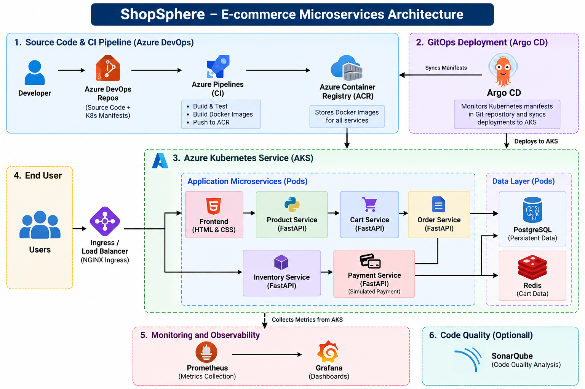
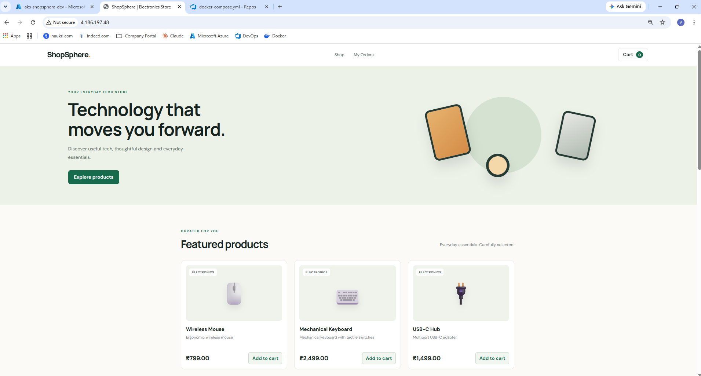
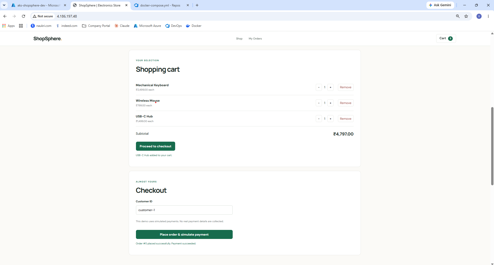
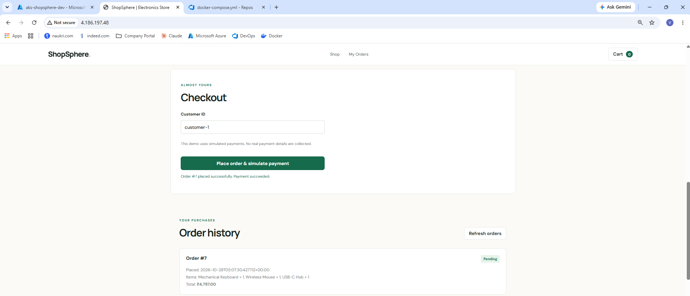
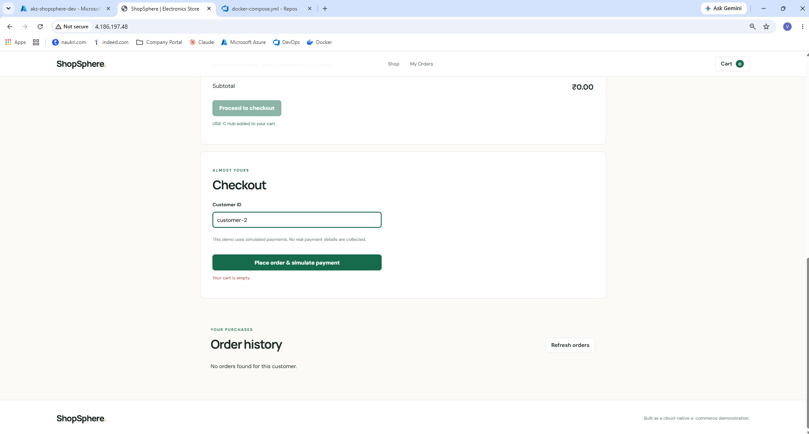
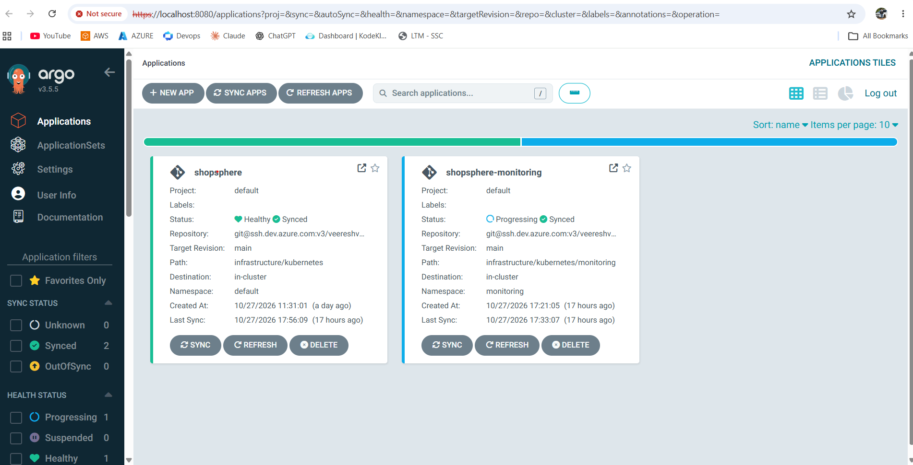
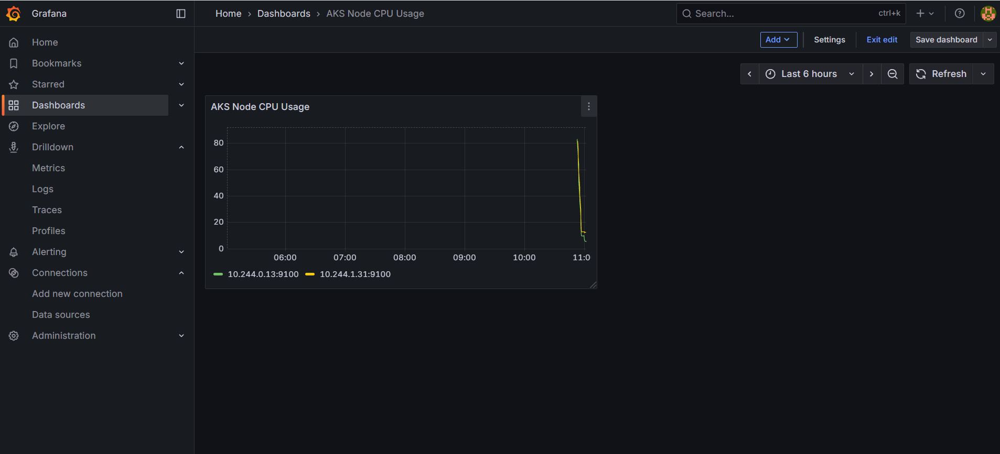
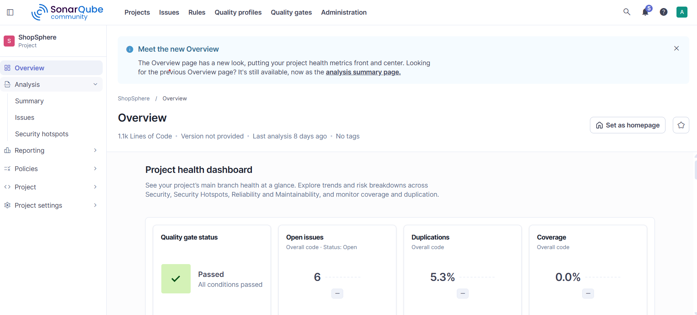

# ShopSphere — E-commerce Microservices on Azure

ShopSphere is a cloud-native e-commerce project that demonstrates the implementation of CI/CD, containerization, Kubernetes orchestration, GitOps, security scanning, and monitoring using Microsoft Azure and open-source DevOps tools.

The application uses an HTML and CSS frontend with six application components, including FastAPI-based product, cart, order, inventory, and simulated payment services.

## Architecture

## Technology Stack

- **Frontend:** HTML, CSS
- **Backend:** Python, FastAPI
- **Data Layer:** PostgreSQL, Redis
- **Cloud Platform:** Microsoft Azure
- **Source Control:** Azure Repos, GitHub
- **CI/CD:** Azure DevOps YAML Pipelines
- **Containerization:** Docker
- **Container Registry:** Azure Container Registry (ACR)
- **Orchestration:** Azure Kubernetes Service (AKS), Kubernetes
- **GitOps:** Argo CD
- **Security Scanning:** Trivy
- **Monitoring:** Prometheus, Grafana
- **Code Quality:** SonarQube

## Key Features

- Containerized application services using Docker.
- Automated CI workflows using Azure DevOps YAML pipelines.
- Container image storage in Azure Container Registry.
- Kubernetes-based application deployment on AKS.
- GitOps-based deployment management using Argo CD.
- Container image vulnerability scanning and report generation using Trivy.
- Infrastructure monitoring and CPU utilization dashboards using Prometheus and Grafana.

## Screenshots

### ShopSphere Application

### Argo CD

### Grafana

### SonarQube

## Repository

[View ShopSphere on GitHub](https://github.com/Veereshmv/ShopSphere)

---

*ShopSphere is a portfolio project demonstrating cloud and DevOps engineering practices.*
